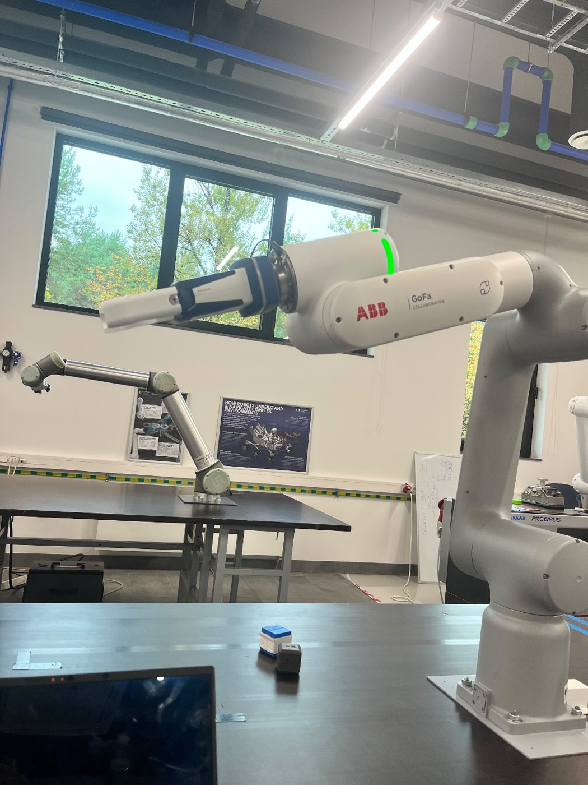
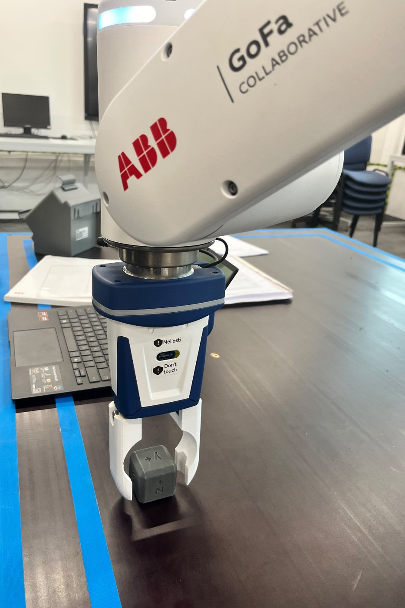
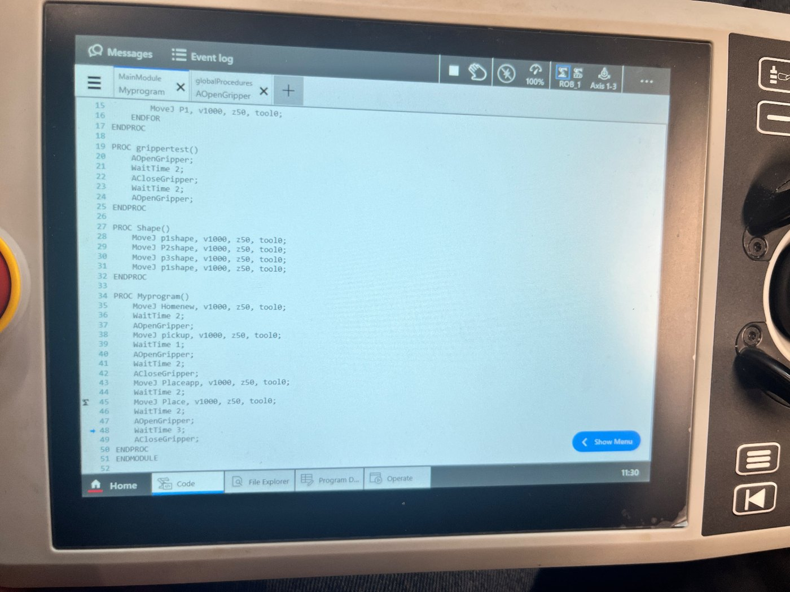
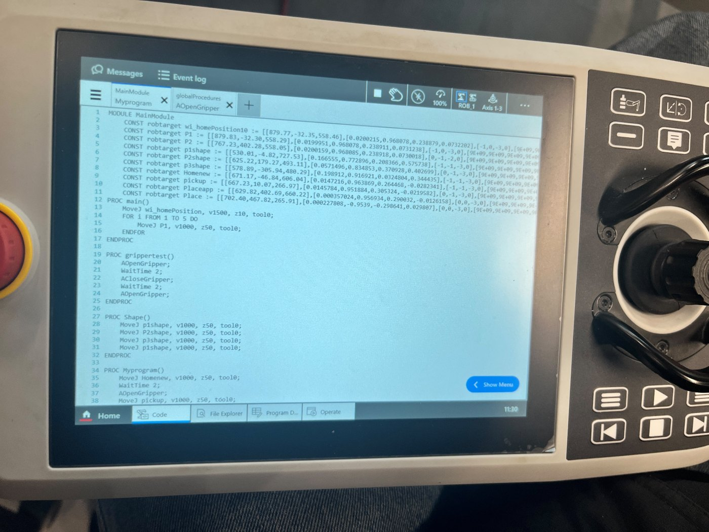
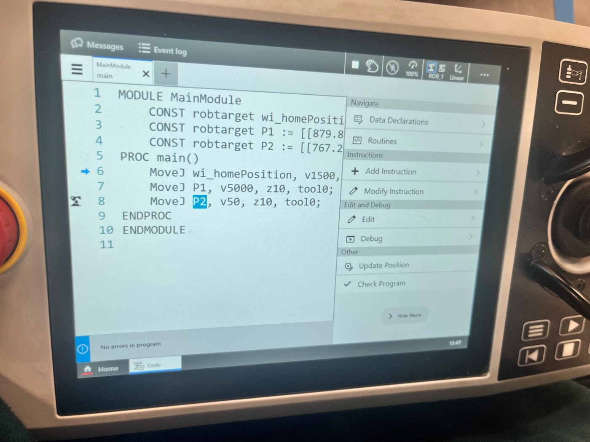
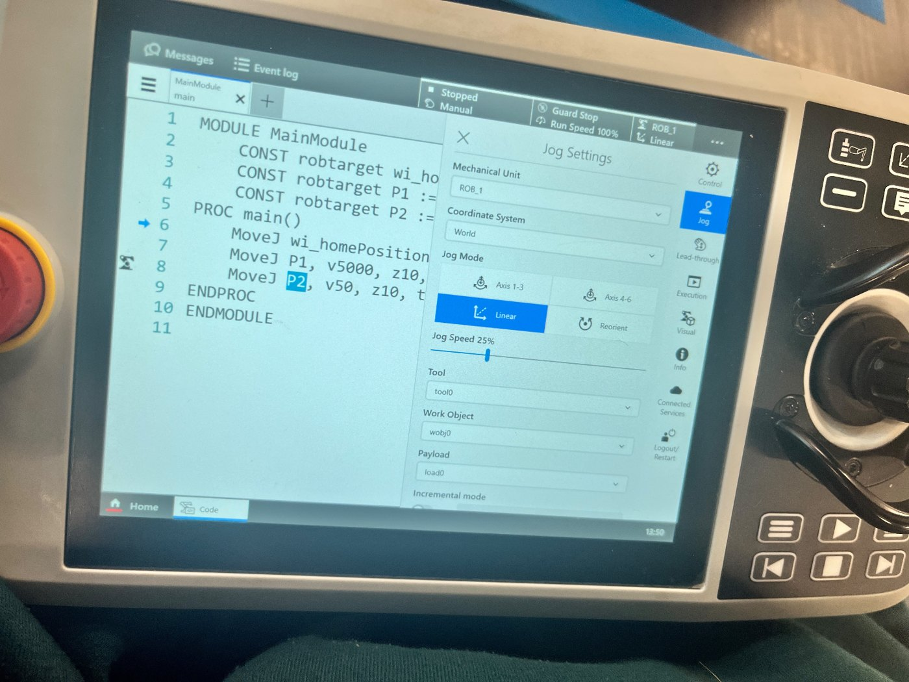

# Lab 01: ABB GoFa (CRB 15000) Robot Programming

Laboratory work at VILNIUS TECH (Applied Artificial Intelligence, course *Robots, Intelligent Automation*) on programming and operating an industrial robot. This repository documents the programs written in RAPID for an ABB GoFa collaborative robot (CRB 15000) with a gripper, using the ABB teach pendant.

## Aim
Learn how industrial robots are controlled and write robot control programs for a robot specified by the teacher.

## Equipment
- ABB GoFa (CRB 15000) collaborative robot
- ABB teach pendant (touchscreen with joystick, emergency stop and program editor)
- Schunk gripper
- Grey cube as the object to manipulate

## What I did
- [x] Learned the pendant controls and safety features: emergency stop button, manual mode, reduced jog speed (25%)
- [x] Wrote robot control programs in RAPID
- [x] Changed the movement speed (v5000 and v50 in the speed demo, jog speed in manual mode)
- [x] Created and used taught target positions (`robtarget`)
- [x] Jogged the robot in different jog modes (Axis 1-3 and Linear) in the World coordinate system
- [x] Controlled the gripper (open and close procedures)
- [x] Repeated a motion a set number of times (`FOR` loop, 5 repetitions)
- [x] Moved the robot along a path through three taught points
- [x] Added pauses of different lengths between movements (`WaitTime` of 1, 2 and 3 seconds)
- [x] Programmed a pick and place of an object

## Programs
| File | What it does |
|------|--------------|
| [speed_demo.mod](speed_demo.mod) | Moves to the home position, then to two taught points at a high speed (v5000) and a low speed (v50) |
| [pick_and_place.mod](pick_and_place.mod) | Home position and repeat loop, gripper test, three-point path, and a pick and place procedure |

The programs were transcribed from photos of the teach pendant. Target coordinates are shown as `...`, and the gripper procedures `AOpenGripper` and `ACloseGripper` are defined in a separate module that is not included.

### Procedures in `pick_and_place.mod`
| Procedure | Description |
|-----------|-------------|
| `main` | Moves to the home position, then repeats a move to `P1` five times |
| `grippertest` | Opens the gripper, waits 2 s, closes it, waits 2 s, opens it again |
| `Shape` | Moves through three taught points and returns to the first |
| `Myprogram` | Goes to a start position, opens the gripper, moves to the pick-up point, closes the gripper, moves to the place approach and place positions, then releases the object |

## Pendant screens
**Program with the gripper, shape and pick-and-place procedures**

**Target declarations and main procedure**

**Speed demo with the program editor menu**

**Jog settings: World coordinate system, Linear jog mode, 25% jog speed**

## Key RAPID concepts used
- `MoveJ target, speed, zone, tool`: joint movement to a target, with speed data (`v1000`, `v5000`, `v50`) and zone data (`z10`, `z50`)
- `robtarget`: a taught position, stored as a constant
- `FOR ... ENDFOR`: repeat a motion a set number of times
- `WaitTime`: pause between movements
- Procedures (`PROC`): reusable blocks such as gripper open and close

## What I learned
- Teaching and naming target positions with the pendant
- How speed and zone data change the way the robot moves
- Splitting a task into procedures, such as a gripper test and a pick and place
- Safe operation in manual mode with a reduced jog speed
